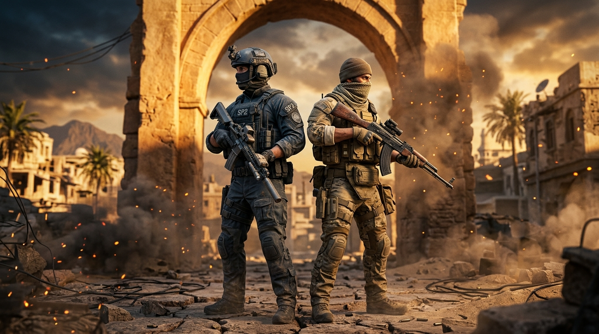
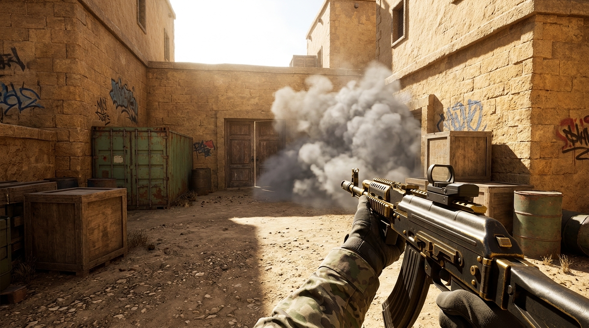
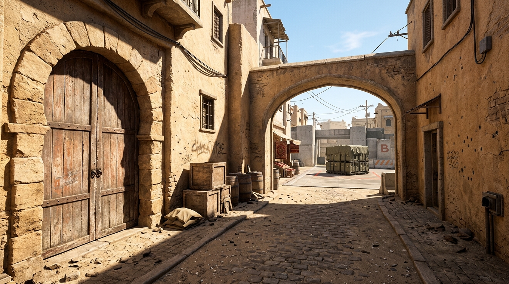
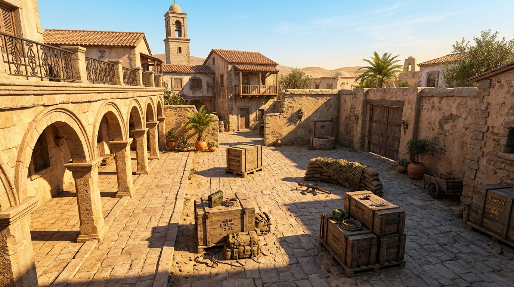
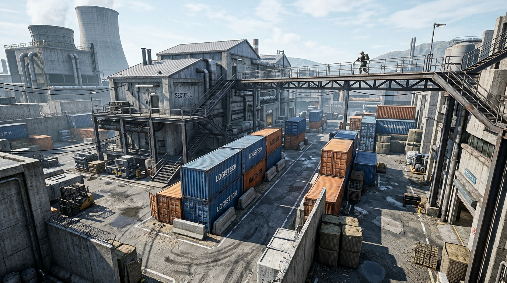
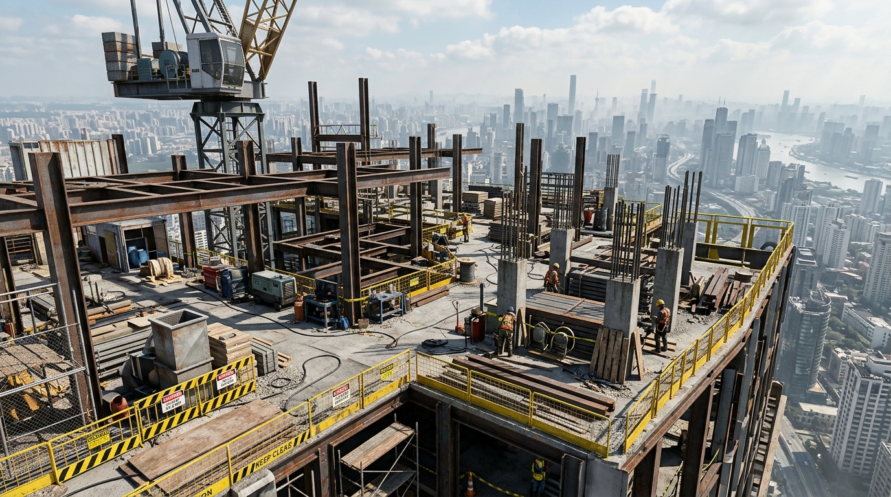
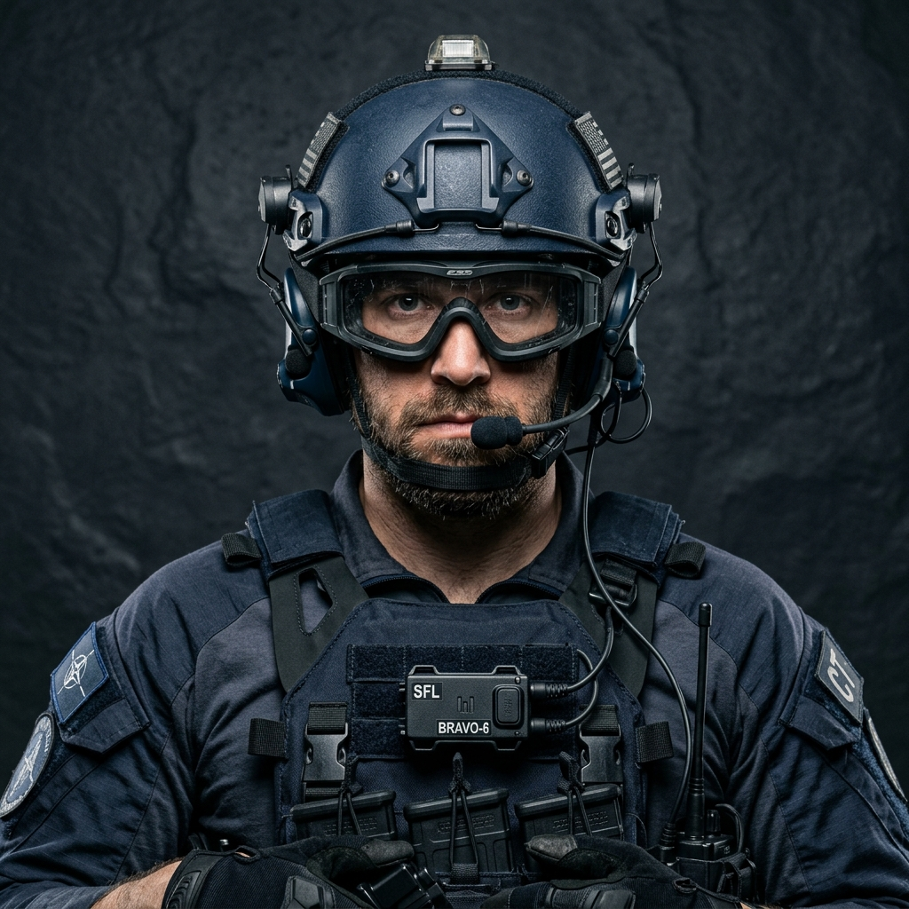
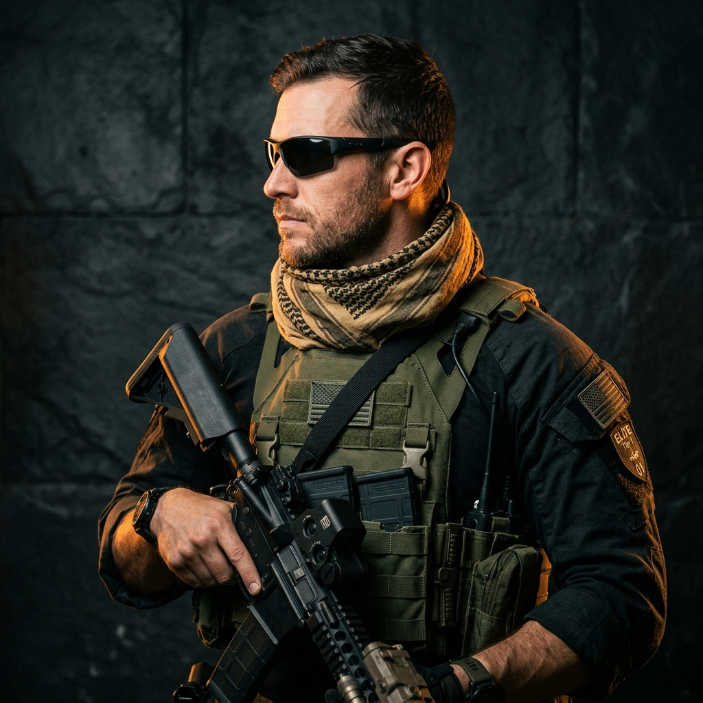

<div align="center">



# 🎯 STRIKEFRONT 2

**Zamonaviy brauzer ichidagi 3D taktik birinchi shaxs otishma o'yini (CS2 uslubida)**  
*Three.js 3D Engine • Haqiqiy 1:1 Dust II • Taktik Granatalar • 5 xonali parolli Local Multiplayer*

<p>
  
  
  
  
  
</p>

<p>
  <a href="#-asosiy-imkoniyatlar">Xususiyatlar</a> •
  <a href="#-xaritalar-galereyasi">Xaritalar</a> •
  <a href="#-jamoalar-va-operatorlar">Jamoalar</a> •
  <a href="#-boshqaruv-tugmalari">Boshqaruv</a> •
  <a href="#-local-multiplayer-5-xonali-parol">Local Ulanish</a> •
  <a href="#-ornatish-va-ishga-tushirish">O'rnatish</a>
</p>

</div>

---

## 🎮 O'yin Ko'rinishi (Gameplay)

<div align="center">
  
  <br />
  <sub><i>Dust II Mid Double Doors — PBR qurol skinlari, devor graffitilari, dinamik yorug'lik va Smoke ("Dimka") effekti</i></sub>
</div>

---

## ⚡ Asosiy Imkoniyatlar

- **🔫 3D Taktik Engine & PBR Qurollar** — Three.js asosidagi yuqori FPS dvigatel, PBR materiallar, qurol skinlari, qurolni ko'zdan kechirish (`F`), qayta o'qlash (`R`), AWP optik nishoni (`RMB`) va Web Audio API orqali jonli ovoz effektlari.
- **🗺️ Asl 1:1 `de_dust2` va 4 ta Xarita** — Klassik Dust II xaritasi haqiqiy tuzilishda: *T Spawn terrace, Suicide, Mid Double Doors, Xbox, Catwalk / Short A, Long Doors, Blue Container, Pit, A Car, A Site / Goose, CT Mid, Upper & Lower B Tunnels, B Site, B Doors va B Window*.
- **🌐 Local Multiplayer (WebSocket)** — Bitta lokal tarmoqda do'stlar bilan o'ynash uchun **5 ta harf va sondan iborat maxsus parol** bilan xona yaratish va ulanish tizimi.
- **💣 Taktik Granatalar** — **HE Frag** (portlovchi), **Flashbang** (ko'zni qamashtiruvchi) va **Smoke / "Dimka"** (tuman pardasi) fizikasi hamda B-menyu orqali xarid qilish.
- **📊 Ikki Jamoaga Ajratilgan `TAB` Jadvali** — O'yin vaqtida `TAB` bosilganda **Maxsus Kuchlar (CT)** va **Terroristlar (T)** alohida jadvalda ko'rinadi (K / D / A, zarar va ochkolar bilan).
- **🎨 Devor Graffitilari va Interaktiv Sprey (`T`)** — Xaritalardagi protsedural devor rasmlari (`GOOSE`, `A ➔`, `⬅ B`, Crown, Viper) hamda o'yin ichida `T` tugmasi bilan devorlarga o'z sprey belgingizni qo'yish imkoniyati.
- **🛠️ Zamonaviy Asosiy Menyu** — 3D qurol/operator ko'rgazmasi, profil nikname va operator tanlash, xarita va o'yin rejimini (**Classic 5v5**, **Deathmatch**, **Aim Arena**) tezkor almashtirish, O'zbek (`UZ`) va Ingliz (`EN`) tillari.
- **🐇 Maxsus Nikname Mexanikasi** — Nikname oxiriga `%`, `&`, `*`, `(`, `)`, `$` belgilaridan biri qo'yilsa, maxsus nishon yordamchisi, dushman nuqtalari va sakrab yugurganda tezlashish (*bunny-hop speed boost*) faollashadi.

---

## 🗺️ Xaritalar Galereyasi

<table>
  <tr>
    <td width="50%" align="center">
      
      <br />
      <b>Dust II (Original 1:1)</b>
      <br />
      <sub>Long A, Pit, Catwalk, Mid Double Doors, Upper/Lower B Tunnels va A/B Saytlar bilan to'liq taktik xarita</sub>
    </td>
    <td width="50%" align="center">
      
      <br />
      <b>Mirage Courtyard</b>
      <br />
      <sub>Ochiq hovli, baland balkonlar va yaqin-o'rta masofadagi tezkor otishmalar uchun arena</sub>
    </td>
  </tr>
  <tr>
    <td width="50%" align="center">
      
      <br />
      <b>Nuke Sector</b>
      <br />
      <sub>Sanoat kompleksi, metall konteynerlar, rampalar va taktik yashirinish nuqtalari</sub>
    </td>
    <td width="50%" align="center">
      
      <br />
      <b>Vertigo Rooftop</b>
      <br />
      <sub>Osmono'par bino tomi, vertikal o'tish yo'llari va snayperlar uchun qulay pozitsiyalar</sub>
    </td>
  </tr>
</table>

---

## 🛡️ Jamoalar va Operatorlar

<table>
  <tr>
    <td width="50%" align="center">
      
      <br />
      <h3>🔵 Maxsus Kuchlar (CT / Spes)</h3>
      <p><sub>M4A1-S, USP-S va taktik mudofaa strategiyasiga ixtisoslashgan elit bo'linma.</sub></p>
    </td>
    <td width="50%" align="center">
      
      <br />
      <h3>🟠 Terroristlar (T / Hujumchilar)</h3>
      <p><sub>AK-47, Glock-18 va tezkor hujumlar (Rush B / Long A) uchun mo'ljallangan jamoa.</sub></p>
    </td>
  </tr>
</table>

---

## ⌨️ Boshqaruv Tugmalari

| Tugma | Vazifasi |
| :---: | :--- |
| **`W` `A` `S` `D`** | Harakatlanish |
| **`Space`** | Sakrash |
| **`C` / `Ctrl`** | O'tirish (Crouch) |
| **`Shift`** | Sekin va ovozsiz yurish |
| **`Chap Sichqoncha (LMB)`** | O'q otish / Granata uloqtirish |
| **`O'ng Sichqoncha (RMB)`** | Snayper nishonini kattalashtirish (AWP Scope) |
| **`1` `2` `3` `4`** | Asosiy qurol, Pistolet, Pichoq va Granatalar |
| **`G`** | Granatani tezkor uloqtirish (HE / Flash / Dimka) |
| **`R`** | O'qdonni almashtirish (Reload) |
| **`F`** | Qurolni ko'zdan kechirish (Inspect) |
| **`T`** | Devorga sprey (graffiti) sepish |
| **`B`** | Qurol va granata xarid menyusi (Buy Menu) |
| **`Tab`** | Ikki jamoaga bo'lingan hisob jadvali (CT vs T) |
| **`P` / `Esc`** | Pauza va xaritani almashtirish menyusi |

---

## 🔗 Local Multiplayer (5 xonali parol)

Do'stlaringiz bilan bir tarmoqda (yoki bitta serverda) o'ynash uchun:

1. Asosiy menyuning o'ng tomonidan **O'yin Turi** qismida **`Local`** tugmasini tanlang.
2. **Xona Yaratish (Host):** Tizim avtomatik ravishda **5 ta harf va raqamdan iborat parol** (masalan, `A7K9M`) beradi. Jamoani tanlang, kerak bo'lsa qo'shimcha botlar sonini (`0–6`) belgilang va o'yinni boshlang.
3. **Xonaga Kirish (Join):** Boshqa o'yinchilar **`Local`** oynasida *"Parolni tering"* maydoniga o'sha 5 xonali kodni kiritib xonaga qo'shiladilar.
4. O'yin ichida barcha o'yinchilar harakati, o'q otish, granatalar, spreylar va jamoa hisoblari `/ws` WebSocket kanali orqali real vaqtda sinxronlanadi.

---

## 🚀 O'rnatish va Ishga Tushirish

Kompyuteringizda ishga tushirish uchun **Node.js (v18+)** o'rnatilgan bo'lishi kerak.

```bash
# 1. Repozitoriyani yuklab oling
git clone https://github.com/<username>/<repo-name>.git
cd <repo-name>

# 2. Kerakli kutubxonalarni o'rnating
npm install

# 3. Ishlab chiqish rejimida ishga tushiring (Port: 3000)
npm run dev
```

Brauzerda **`http://localhost:3000`** manzilini oching.

### Ishlab chiqarish (Production) uchun yig'ish

```bash
npm run build
npm start
```

---

## 📁 Loyiha Tuzilishi

```text
├── server.ts                  # Express server + WebSocket (/ws) local multiplayer xonalari
├── index.html                 # HTML kirish nuqtasi
├── package.json               # Skriptlar va bog'liqliklar
└── src/
    ├── App.tsx                # Asosiy ilova holati va ekranlar boshqaruvi
    ├── components/
    │   ├── MainMenu.tsx       # 3-qismli zamonaviy menyu, Local ulanish modali, Skin & Loadout
    │   └── GameHUD.tsx        # O'yin HUD, radar, B-menyu, split CT/T TAB jadvali
    ├── data/
    │   ├── i18n.ts            # O'zbek (UZ) va Ingliz (EN) til paketlari
    │   ├── maps.ts            # Dust II, Mirage, Nuke, Vertigo xarita ma'lumotlari
    │   └── weapons.ts         # Qurollar, granatalar va skinlar statistikasi
    ├── game/
    │   ├── engine.ts          # Three.js 3D FPS dvigateli, fizika, bot AI va sprey tizimi
    │   ├── models.ts          # Qurol, operator va granata 3D modellari
    │   ├── textures.ts        # Protsedural PBR teksturalar va devor graffitilari
    │   ├── audio.ts           # Web Audio API tovush sintezi
    │   └── multiplayerClient.ts # WebSocket mijoz sinxronizatsiyasi
    └── assets/images/         # Banner, gameplay, xarita va operator rasmlari
```

---

<div align="center">
  <sub><b>StrikeFront 2</b> — Taktika, aniqlik va jamoaviy g'alaba.</sub>
</div>
